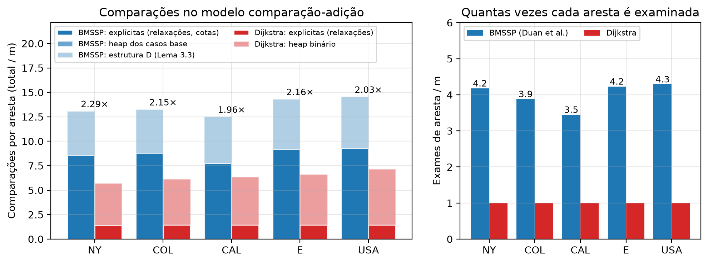
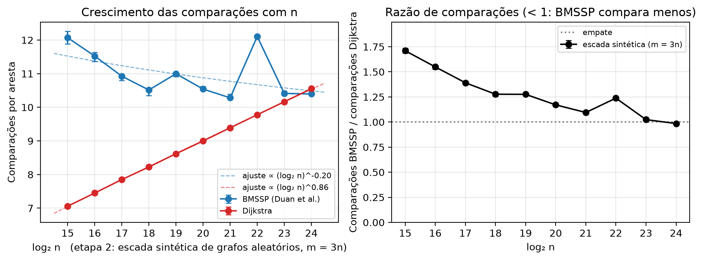
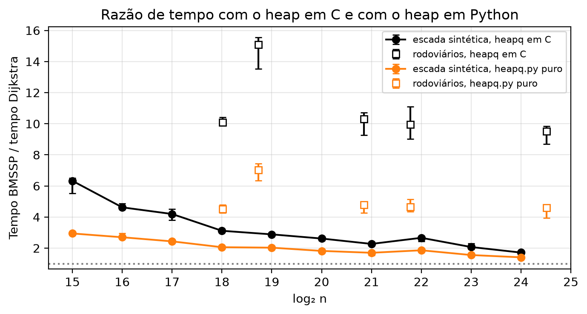

# SortingBarrier-vs-Djikstra

Implementação em Python do algoritmo de **Duan, Mao, Mao, Shu e Yin (2025), "Breaking the Sorting
Barrier for Directed Single-Source Shortest Paths"** ([arXiv:2504.17033](https://arxiv.org/abs/2504.17033)),
o primeiro SSSP determinístico em `O(m log^(2/3) n)` para grafos dirigidos com pesos não negativos,
e comparação experimental com o Dijkstra nas malhas rodoviárias do 9th DIMACS Implementation Challenge.

Trabalho da disciplina PCA (UnB). O repositório contém o código, o protocolo do experimento,
os dados coletados e as figuras.

- [1. O algoritmo em uma página](#1-o-algoritmo-em-uma-página)
- [2. O código](#2-o-código)
- [3. Dataset](#3-dataset)
- [4. Como rodar](#4-como-rodar)
- [5. O experimento](#5-o-experimento)
- [6. Resultados](#6-resultados)
- [7. Ambiente](#7-ambiente)
- [8. Arquivos](#8-arquivos)

---

## 1. O algoritmo em uma página

O Dijkstra extrai os vértices em ordem crescente de distância, e isso o obriga a pagar uma ordenação
(`n log n`). O artigo mostra que não é preciso ordenar todos os vértices: basta descobrir, a cada
passo, um conjunto pequeno de **pivôs** cujas subárvores cobrem o restante da fronteira, e recorrer
sobre faixas de distância cada vez menores.

Três rotinas, nomeadas como no artigo:

| Rotina | Algoritmo no artigo | O que faz |
|---|---|---|
| `FindPivots(B, S)` | Algoritmo 1 (Lema 3.2) | Faz `k` passos de Bellman-Ford a partir de `S` dentro da cota `B`. Se a fronteira cresce demais (`> k·|S|`), desiste e devolve `S` inteiro como pivôs. Senão, devolve como pivôs só as raízes de árvores de caminhos mínimos com pelo menos `k` vértices. |
| `BaseCase(B, {x})` | Algoritmo 2 | Mini-Dijkstra a partir de um único vértice, parando em `k+1` vértices extraídos ou quando a cota `B` é atingida. É a folha da recursão. |
| `BMSSP(l, B, S)` | Algoritmo 3 (Lema 3.1) | Nível `l` da recursão. Chama `FindPivots`, insere os pivôs na estrutura `D`, e repete: `Pull` retira os `M = 2^((l-1)t)` menores, recorre em `BMSSP(l-1, B_i, S_i)`, relaxa as arestas dos vértices completados e devolve a `D` o que sobrou (`Insert` para o que ficou acima de `B_i`, `BatchPrepend` para o que ficou abaixo). Para quando `|U| ≥ k·2^(lt)` ou `D` esvazia. |

A **estrutura `D`** (Lema 3.3) é uma lista de blocos ordenados que suporta `Insert` em `O(log(N/M))`
amortizado, `BatchPrepend` de `L` itens em `O(L·log(L/M))` e `Pull` dos `M` menores em `O(M)`.
Ela substitui o heap do Dijkstra e é o que faz a parte logarítmica do custo cair de `log n` para
`log^(2/3) n`.

**Parâmetros**: `k = ⌊log^(1/3) n⌋`, `t = ⌊log^(2/3) n⌋`, nível máximo `l = ⌈log n / t⌉`.
Para os grafos deste trabalho isso dá `k = 2`, `t` entre 6 e 8 e `l` entre 3 e 4.

**Modelo de custo**: comparação-adição. Só comparações e adições entre valores de distância contam.
É nesse modelo que o artigo prova `O(m log^(2/3) n)`, e é nele que medimos.

**Hipótese 2.1 (ordem total)**: o artigo supõe que todos os caminhos têm comprimentos distintos. O
código realiza isso comparando chaves `(distância, nº de arestas, vértice)` e, em empate total,
o predecessor, de modo que o algoritmo funciona em grafos reais com muitos pesos repetidos.

---

## 2. O código

Quatro módulos, sem dependências externas além do `matplotlib` para as figuras.

### `bmssp.py`: o algoritmo

| Símbolo | Linha | Papel |
|---|---|---|
| `usar_heap` | 54 | Escolhe o heap dos dois algoritmos: `"c"` é o `heapq` acelerado (padrão); `"python"` carrega o mesmo `heapq.py` da biblioteca padrão sem o módulo `_heapq`, para medir a parcela do interpretador. |
| `_Chave`, `_push_contado`, `_pop_contado` | 73, 87, 91 | Chave da execução de contagem: cada `<` executado incrementa `_Chave.n`. É o que torna exata a contagem do heap e da estrutura `D`. |
| `Graph` | 98 | Grafo dirigido. `adj[u]` é uma tupla intercalada `(v0, w0, v1, w1, ...)` com objetos `int` compartilhados: 16 bytes por arco em vez de ~160 de uma lista de tuplas. É o que permite carregar o grafo USA (58 M arcos) em ~3 GB. `add_edge` acumula; `arcs(u)` itera em pares. |
| `to_constant_degree` | 123 | Transformação da Seção 2 do artigo: cada vértice vira um ciclo de peso 0 com um nó por aresta incidente, de modo que todo grau fique ≤ 2. Usada só para validar que o algoritmo se comporta igual com e sem a hipótese de grau constante. |
| `_Block`, `_bisect_contado`, `_particiona`, `_selecao`, `BlockDS` | 160, 168, 184, 192, 222 | A estrutura `D` do Lema 3.3. `D0` é um `deque` de blocos recebidos por `BatchPrepend`; `D1` é uma lista de blocos com cotas superiores (`uppers`), localizados por `bisect`. `where` mapeia chave → bloco para remoção em `O(1)`. Os `k` menores (divisão de bloco pela mediana, `Pull`, `BatchPrepend`) são escolhidos por `_selecao`, um quickselect com pivô aleatório: `O(L)` comparações esperadas, uma por elemento em cada partição (`_particiona`). O artigo cita a seleção determinística de [BFP+73] para o mesmo passo; só a garantia muda, de pior caso para esperada. Com `contar=True` conta cada comparação executada (`_bisect_contado`, `_particiona`). |
| `DuanSSSP` | 391 | O solver. Guarda `d` (distância provisória), `h` (nº de arestas, desempate) e `pred`. `key(v)` monta a chave da ordem total; `_can_relax` aplica a relaxação com `≤` da Observação 3.4; `_apply` atualiza `d`, `h`, `pred`. |
| `DuanSSSP.find_pivots` | 468 | Algoritmo 1. |
| `DuanSSSP.base_case` | 538 | Algoritmo 2, com heap binário (`usar_heap`) e remoção preguiçosa. |
| `DuanSSSP.bmssp` | 604 | Algoritmo 3. Registra por nível (`self.niveis`) o número de chamadas, as parciais, `|S|` e `|U|` máximos e as cotas do Lema 3.9. |
| `DuanSSSP._fecha_contagem` | 694 | Consolida as contagens no modelo comparação-adição (tabela abaixo). |
| `DuanSSSP.run` | 707 | Chama `bmssp(l, ∞, {s})` e devolve o vetor de distâncias. |
| `dijkstra` | 720 | Dijkstra com heap binário (`usar_heap`) e remoção preguiçosa. |
| `random_graph` | 767 | Grafos aleatórios: árvore geradora com arcos nos dois sentidos (todo vértice alcança todos) mais arcos aleatórios até `m`. |
| `main` | 787 | CLI com logs por nível de recursão, útil para acompanhar a execução em grafos pequenos. |

**O que é contado como comparação.** Tudo é contado por eventos, exatamente. O que depende da
implementação interna do heap e da estrutura `D` é contado numa execução separada, em que as chaves
são embrulhadas em `_Chave` e cada `<` executado incrementa um contador.

| Contador | Como é obtido |
|---|---|
| `arestas_examinadas` | uma adição `d[u] + w` e uma comparação com `d[v]` por aresta examinada |
| `heap_pops` | uma comparação por extração, para o teste de entrada obsoleta |
| `comparacoes_cotas` | comparações com as cotas `B`, `B_i`, `B'_i` e o teste de aresta justa no `FindPivots` (por diferença dos contadores de relaxação) |
| `comparacoes_heap` | cada `<` executado pelo `heapq` (itens `_Chave`) |
| `comparacoes_D` | cada `<` executado na estrutura `D`: busca binária das cotas, partições do quickselect, testes de melhoria no `Insert` e no `BatchPrepend`, mínimos do `Pull` |
| `comparacoes_total` | soma dos anteriores |

O Dijkstra é contado com as mesmas regras (`arestas_examinadas + pops + comparacoes_heap`).

### `dimacs.py`: leitura e validação

`load_gr(caminho, Graph)` lê um `.gr` ou `.gr.gz` do DIMACS direto para a representação compacta:
arcos em `array`, ordenação por origem por contagem, e montagem das tuplas intercaladas. Nunca cria
listas por vértice, por isso o pico de memória fica em ~1,6× o tamanho final.
`random_sources(n, quantidade, seed)` sorteia as fontes do benchmark de forma reprodutível.
`python3 dimacs.py --check arquivo.gr.gz` confere a contagem de arcos, pesos negativos, laços,
grau máximo e vértices isolados.

### `benchmark.py`: o protocolo

Para cada grafo e cada fonte sorteada:

1. Os dois algoritmos partem da **mesma fonte**.
2. A **ordem alterna** a cada fonte (BMSSP primeiro nas pares, Dijkstra nas ímpares) para que nenhum
   dos dois se beneficie sistematicamente do cache aquecido pelo outro.
3. Cada execução cronometrada roda com o **garbage collector desligado**, e a carga do grafo fica
   fora do tempo.
4. As **distâncias são conferidas** vértice a vértice; qualquer divergência aborta com código 1.
5. Uma **segunda execução de cada algoritmo**, com `contar=True`, coleta as comparações. Ela não entra
   no tempo, então a instrumentação não contamina a medida.
6. Há um **aquecimento** (uma execução de cada) antes da primeira fonte de cada grafo.
7. Com `--heap both`, cada fonte é cronometrada duas vezes por algoritmo: com o `heapq` em C e com
   o `heapq.py` puro, trocados nos dois algoritmos ao mesmo tempo (Dijkstra e `BaseCase`). A
   contagem é feita uma vez por fonte, porque não depende do heap.

A saída é um CSV com uma linha por par de execuções e ~100 colunas: identificação do grafo e dos
parâmetros (`n`, `m`, `k`, `t`, `nivel_topo`, `heap`, `fonte`, `primeiro`), tempos e razão, todos os
contadores do BMSSP e do Dijkstra com prefixos `bmssp_` e `dijkstra_`, `razao_comparacoes`, e para
cada nível `l` de 0 a 6 as colunas `nivel{l}_{chamadas, parciais, iteracoes, S_max, S_cota, U_max,
U_cota, U_medio}`.

### `graficos.py`: as figuras

Lê os CSVs e escreve as figuras em PNG e PDF, separadas por etapa: `figuras/etapa1` (fig1, fig2,
fig6, fig8), `figuras/etapa2` (fig3, fig4, fig5 e a subpasta `previsao`, com as extrapolações),
`figuras/etapa3` (fig7) e `figuras/complemento` (fig9, heap em Python). Cada função `fig_*` gera uma
figura. As figuras 1 a 8 usam as linhas com `heap=c`.

---

## 3. Dataset

Malhas rodoviárias dos EUA do 9th DIMACS Implementation Challenge, série `USA-road-d` (pesos =
distância). Grafos dirigidos: cada via de mão dupla aparece como dois arcos. Todos são fortemente
conexos na prática (toda fonte sorteada alcançou todos os vértices).

| Arquivo | Vértices | Arcos | .gz |
|---|---|---|---|
| USA-road-d.NY.gr.gz | 264.346 | 733.846 | 3,7 MB |
| USA-road-d.COL.gr.gz | 435.666 | 1.057.066 | 5,8 MB |
| USA-road-d.CAL.gr.gz | 1.890.815 | 4.657.742 | 27 MB |
| USA-road-d.E.gr.gz | 3.598.623 | 8.778.114 | 52 MB |
| USA-road-d.USA.gr.gz | 23.947.347 | 58.333.344 | 351 MB |

Os arquivos não estão no repositório. Baixe para uma pasta `data/` ao lado dele:

```bash
mkdir -p ../data && cd ../data
for g in NY COL CAL E USA; do
  curl -fLO https://www.diag.uniroma1.it/challenge9/data/USA-road-d/USA-road-d.$g.gr.gz
done
gzip -t *.gz
python3 ../SortingBarrier-vs-Djikstra/dimacs.py --check USA-road-d.NY.gr.gz
```

O servidor às vezes encerra conexões longas; se `gzip -t` falhar, baixe o arquivo de novo do zero
(retomar com `curl -C -` produziu um arquivo corrompido durante este trabalho).

Formato (`.gr`, texto dentro do gzip): linhas `c` são comentários, `p sp n m` é o cabeçalho e
cada `a u v w` é um arco dirigido `u → v` de peso `w`, com vértices de 1 a `n`.

---

## 4. Como rodar

Requisitos: Python 3.12 (sem dependências para os algoritmos). Para as figuras:

```bash
python3 -m venv ../.venv && ../.venv/bin/pip install matplotlib
```

Acompanhar o algoritmo em um grafo pequeno, com log de cada chamada recursiva:

```bash
python3 bmssp.py --exemplo
python3 bmssp.py -n 50 --seed 3 --log DEBUG
python3 bmssp.py -n 3000 --seed 7 --grau-constante --log WARNING
```

Rodar as três etapas do experimento (tempos aproximados nesta máquina):

```bash
# Etapa 1: grafos reais, parâmetros do artigo, heap em C e em Python (~45 min para NY, COL, CAL, E; ~1 h para o USA)
python3 benchmark.py ../data/USA-road-d.{NY,COL,CAL,E}.gr.gz --fontes 10 --heap both --saida resultados.csv
python3 benchmark.py ../data/USA-road-d.USA.gr.gz --fontes 3 --heap both --saida resultados_usa.csv

# Etapa 2: escada sintética (~2,5 h; só até 2^21 são ~30 min)
python3 benchmark.py --sintetico 15 16 17 18 19 20 21 22 23 24 --fontes 3 --heap both --saida resultados_sintetico.csv

# Etapa 3: controle com k e t fixos, só tempo (~15 min)
python3 benchmark.py ../data/USA-road-d.{NY,COL,CAL,E}.gr.gz --fontes 3 -k 2 -t 6 --sem-contagem --saida resultados_kt_fixo.csv

# Figuras
../.venv/bin/python graficos.py
```

Memória: o USA usa ~3,2 GB para o grafo e o benchmark completo chega a 12,5 GB de pico (dois
solvers mais a execução de contagem). O grafo aleatório de `2^24` fica em ~10 GB e o E em ~2 GB.

---

## 5. O experimento

Todas as etapas compartilham o protocolo da seção 2 (`benchmark.py`). A métrica de complexidade é a
**contagem exata de comparações**: é a grandeza sobre a qual o artigo faz afirmações e é
determinística (a mesma fonte dá a mesma contagem em qualquer máquina). O tempo de parede entra como
medida prática: é a contagem vezes um custo por comparação que não é o mesmo nos dois algoritmos e
que varia com cache e interpretador, então ele não serve para ajustar expoentes.

### Etapa 1: grafos reais com os parâmetros do artigo

**Pergunta.** Em dados reais, quem ganha e por quanto?

**Como.** As cinco malhas rodoviárias, com `k` e `t` calculados de cada grafo como no artigo. Dez
fontes sorteadas por grafo (seed 42), três no USA.

**Mede.** Tempo, comparações separadas por origem (explícitas, heap, estrutura `D`), quantas vezes
cada aresta é examinada, chamadas e cotas por nível.

### Etapa 2: escada sintética

**Pergunta.** Como o custo cresce com `n`: como `m log^(2/3) n`, que é o que o artigo prevê, ou
como `m log n`, que é o Dijkstra?

**Por que grafos sintéticos.** Complexidade é uma afirmação sobre como o custo cresce quando só `n`
muda. Os cinco grafos reais têm estruturas diferentes entre si, então uma diferença entre NY e CAL
pode ser tamanho ou pode ser geografia. A escada fixa a família (aleatórios com `m = 3n`, pesos
inteiros em `[1, 10000]`, seed 7) e varia só `n`, de `2^15` a `2^24`. Três fontes por tamanho. O
`2^24` tem o tamanho do USA e é o maior que cabe na memória com a execução de contagem.

**Mede.** Comparações por aresta em função de `log n` com expoente ajustado, razão de comparações,
razão de tempo.

### Etapa 3: controle de parâmetros

**Pergunta.** O COL destoou na etapa 1 com razão de tempo 13 contra 9 dos outros. É culpa do
`t = 7` ou da estrutura do grafo?

**Como.** NY, COL, CAL e E de novo, com `k = 2` e `t = 6` fixos em todos. Assim a única diferença
entre os grafos é o grafo. Três fontes, só tempo.

### Complemento: heap em Python

**Pergunta.** Quanto da diferença de tempo é o interpretador? O heap do Dijkstra (`heapq`) roda em
C, enquanto pivôs, estrutura `D` e recursão do BMSSP rodam em Python puro.

**Como.** As etapas 1 e 2 inteiras, repetidas com o `heapq.py` puro da biblioteca padrão nos dois
algoritmos (`--heap both`), na mesma execução e com o mesmo grafo em memória que as medições com o
heap em C.

---

## 6. Resultados

Todas as 146 execuções cronometradas (73 fontes × 2 heaps) e as 73 de contagem produziram
distâncias idênticas às do Dijkstra.

### Etapa 1

Medianas entre as fontes, heap em C. "Exames" é quantas vezes cada aresta é examinada (o Dijkstra
examina cada uma exatamente uma vez).

| Grafo | n | k, t, l | Fontes | BMSSP | Dijkstra | Razão tempo | Comp./aresta BMSSP | Comp./aresta Dijkstra | Razão comparações | Exames |
|---|---|---|---|---|---|---|---|---|---|---|
| NY | 264 k | 2, 6, 4 | 10 | 2,35 s | 0,23 s | 10,1 | 13,1 | 5,7 | 2,29 | 4,2 |
| COL | 436 k | 2, 7, 3 | 10 | 5,49 s | 0,37 s | 15,1 | 13,3 | 6,2 | 2,16 | 3,9 |
| CAL | 1,89 M | 2, 7, 3 | 10 | 18,0 s | 1,76 s | 10,3 | 12,5 | 6,4 | 1,96 | 3,5 |
| E | 3,60 M | 2, 7, 4 | 10 | 35,1 s | 3,57 s | 9,9 | 14,3 | 6,6 | 2,16 | 4,2 |
| USA | 23,9 M | 2, 8, 4 | 3 | 255 s | 27,1 s | 9,5 | 14,5 | 7,2 | 2,04 | 4,3 |

Em tempo o Dijkstra vence por 9,5 a 15 vezes, e a razão não depende de n: NY e USA, que diferem
em 90 vezes no tamanho, dão 10,1 e 9,5. Em comparações o BMSSP custa 2,0 a 2,3 vezes mais, e a
decomposição mostra onde: as comparações explícitas dele são 7,8 a 9,3 por aresta contra 1,4 do
Dijkstra, porque cada aresta é examinada 3,5 a 4,3 vezes (`FindPivots` relaxa, a recursão relaxa de
novo em cada nível, o `BaseCase` relaxa de novo). A estrutura `D` custa 4,5 a 5,3 por aresta, o
mesmo que o heap inteiro do Dijkstra (4,3 a 5,7): a parte logarítmica dos dois algoritmos empata nas
estradas e todo o excesso do BMSSP está nos exames repetidos. As constantes normalizadas são
estáveis em todos os tamanhos: `comparações / (m·log^(2/3) n)` entre 1,65 e 1,91 para o BMSSP e
`comparações / (m·log n)` entre 0,29 e 0,33 para o Dijkstra.



Outras figuras desta etapa em `figuras/etapa1/`: `fig1_tempo_reais` (tempo por grafo) e `fig8_dispersao_fontes` (dispersão entre fontes).

### Etapa 2

Heap em C, mediana de 3 fontes por tamanho.

| n | k, t, l | Razão tempo | Comp./aresta BMSSP | Comp./aresta Dijkstra | Razão comparações |
|---|---|---|---|---|---|
| 2^15 | 2, 6, 3 | 6,33 | 12,1 | 7,1 | 1,71 |
| 2^16 | 2, 6, 3 | 4,62 | 11,5 | 7,4 | 1,55 |
| 2^17 | 2, 6, 3 | 4,20 | 10,9 | 7,9 | 1,39 |
| 2^18 | 2, 6, 3 | 3,12 | 10,5 | 8,2 | 1,28 |
| 2^19 | 2, 7, 3 | 2,89 | 11,0 | 8,6 | 1,28 |
| 2^20 | 2, 7, 3 | 2,62 | 10,5 | 9,0 | 1,17 |
| 2^21 | 2, 7, 3 | 2,27 | 10,3 | 9,4 | 1,10 |
| 2^22 | 2, 7, 4 | 2,67 | 12,1 | 9,8 | 1,24 |
| 2^23 | 2, 8, 3 | 2,07 | 10,4 | 10,2 | 1,02 |
| 2^24 | 2, 8, 3 | 1,72 | 10,4 | 10,6 | **0,985** |

**O cruzamento acontece, e está medido.** As comparações por aresta do Dijkstra crescem em linha
reta com `log n`, 0,39 por duplicação (expoente ajustado 0,86, com o heap passando de 5,7 para 9,2
por aresta): é o `Θ(m log n)` do heap binário. As do BMSSP **caem** de 12,1 para 10,4 (expoente
−0,20), por dois efeitos: a parte explícita cai de 6,6 para 4,7 por aresta, porque com `t` maior os
retornos parciais rareiam e cada aresta é examinada menos vezes (3,0 → 2,1), enquanto a estrutura
`D` fica plana em 5,3 a 5,7 por aresta, como o Lema 3.3 prevê para uma `D` com seleção linear. O
degrau em `2^22` é o nível extra: `l` passa de 3 para 4 e cada aresta ganha mais um exame (3,1). A
razão cai de 1,71 para 1,02 em `2^23` e para 0,985 em `2^24`, abaixo de 1 nas três fontes
(0,992, 0,985, 0,985): **a partir de n ≈ 1,7 × 10^7 vértices o BMSSP faz menos comparações que o
Dijkstra**, que é o que o artigo prevê. A razão de tempo cai de 6,3 para 1,7 e não cruza.



As constantes normalizadas contam a mesma história: `comparações / (m·log^(2/3) n)` do BMSSP cai de
1,98 para 1,25, ou seja, na nossa faixa ele cresce mais devagar que a própria cota, enquanto
`comparações / (m·log n)` do Dijkstra fica plana em 0,44 a 0,47 (`figuras/etapa2/fig5_constantes`).
Tempo absoluto e razão de tempo: `figuras/etapa2/fig4_escada_tempo`.

**Por que tão tarde.** Com as fórmulas do artigo, `k = 2` para qualquer grafo que caiba numa máquina
(`k = 3` só a partir de `2^27` vértices) e `t` anda uma unidade a cada poucas duplicações de `n`. Os
parâmetros que carregam a assíntota quase não mudam na faixa alcançável; o que o BMSSP ganha por
duplicação é só a diferença entre o `log n` do heap do Dijkstra e o custo quase constante da `D`.

### Complemento: heap em Python

| Grafo | Razão de tempo, `heapq` em C | Razão de tempo, `heapq.py` puro | Dijkstra ficou mais lento |
|---|---|---|---|
| NY | 10,1 | 4,5 | 2,3× |
| COL | 15,1 | 7,0 | 2,1× |
| CAL | 10,3 | 4,8 | 2,2× |
| E | 9,9 | 4,7 | 2,1× |
| USA | 9,5 | 4,6 | 2,1× |
| 2^15 | 6,3 | 2,9 | 2,0× |
| 2^21 | 2,3 | 1,7 | 1,3× |
| 2^24 | 1,7 | 1,4 | 1,2× |

Trocar o `heapq` em C pelo `heapq.py` puro nos dois algoritmos dobra o tempo do Dijkstra nas
estradas e corta a razão pela metade. O BMSSP não muda (±2%): o heap do `BaseCase` é uma parte
pequena dele. Ou seja, nas estradas metade da diferença de tempo é o heap em C; a outra metade é o
algoritmo, quatro exames por aresta e a estrutura `D` em Python puro. Na escada o efeito encolhe
com `n`: em `2^24` o Dijkstra fica só 21% mais lento com o heap em Python, porque o tempo dele passa
a ser dominado por acessos aleatórios à memória e não pelo heap. O cruzamento em tempo não acontece
até `2^24` com nenhum dos dois heaps.



### Etapa 3

| Grafo | Razão (artigo) | Razão (k=2, t=6) | Casos base (artigo) | Casos base (fixo) |
|---|---|---|---|---|
| NY | 10,1 (t=6) | 10,2 | 12 k | 12 k |
| COL | 15,1 (t=7) | 13,3 | 199 k | 101 k |
| CAL | 10,3 (t=7) | 10,4 | 386 k | 157 k |
| E | 9,9 (t=7) | 9,6 | 350 k | 120 k |

Fixar `t` tira 1,8 ponto da razão do COL e move os outros em menos de 0,3; o COL continua três
pontos acima deles com parâmetros iguais. Um terço do desvio é parâmetro, dois terços é estrutura
do grafo. O BMSSP é sensível ao grafo de um modo que o Dijkstra não é. Figura: `figuras/etapa3/fig7_kt_fixo`.

### Cotas do Lema 3.9

O lema garante `|U| ≤ 4k·2^(lt)` e `|S| ≤ 2^(lt)` em toda chamada de nível `l`. Em todos os grafos
e níveis, `|U|` ficou abaixo de 33% da cota (pior caso 0,327) e `|S|` no máximo igual à cota
(igualdade só nos níveis 0 e 1, onde ela vale 1 e `2^t`). Figura: `figuras/etapa1/fig6_niveis_lema39`.

### Previsões (curiosidade)

Prolongando os ajustes da escada (`figuras/etapa2/previsao/`): as retas de comparações por aresta,
lineares em `log₂ n`, se encontram em `n ≈ 2^24` (±3 no expoente), que é onde a medição cruzou. As
leis de potência do tempo, `n^1,12` para o BMSSP e `n^1,30` para o Dijkstra (`n^1,23` com heap em
Python), se encontrariam em `n ≈ 2^28` com o heap em C, com umas 3 h por fonte e memória de
centenas de GB, e em `n ≈ 2^29` com heap em Python. São extrapolações de dez pontos numa faixa
estreita de `log n`, com `t` e `l` mudando em degraus: ordens de grandeza, não previsões.

### Em resumo

- No modelo do artigo, o BMSSP custa 2,0 a 2,3 vezes mais comparações nos grafos reais e cruza o
  Dijkstra na escada sintética em `n ≈ 2^24`: 1,02 em `2^23`, 0,985 em `2^24`.
- O crescimento com `n` é o previsto: Dijkstra sobe com `log n` (expoente 0,86); BMSSP fica plano
  ou cai (expoente −0,20), com a estrutura `D` constante por aresta e os exames diminuindo.
- Em tempo o Dijkstra vence por 9,5 a 15 vezes nas estradas e por 1,7 em `2^24`, e não cruza em
  nenhum tamanho que cabe na máquina. Metade da diferença nas estradas é o heap em C; a outra
  metade é o algoritmo.
- A sensibilidade à estrutura do grafo (COL) é majoritariamente do grafo, não dos parâmetros.
- Todas as cotas do Lema 3.9 fecharam.

---

## 7. Ambiente

Intel Core i5-1135G7 (4 núcleos, L2 5 MiB, L3 8 MiB), 24 GB de RAM, Ubuntu 24.04.5, Python 3.12.3,
sem bibliotecas de aceleração. Tudo single-thread. Os tempos são por fonte, medidos com
`time.perf_counter` e GC desligado. As fontes dos CSVs são 1-indexadas como nos arquivos DIMACS.

---

## 8. Arquivos

| Arquivo | Conteúdo |
|---|---|
| `bmssp.py`, `dimacs.py`, `benchmark.py`, `graficos.py` | código |
| `resultados.csv` | etapa 1, NY/COL/CAL/E, 80 linhas (40 fontes × 2 heaps) |
| `resultados_usa.csv` | etapa 1, USA, 6 linhas |
| `resultados_sintetico.csv` | etapa 2, 2^15 a 2^24, 60 linhas |
| `resultados_kt_fixo.csv` | etapa 3, 12 linhas (sem contagem de comparações) |
| `benchmark_estradas.log`, `benchmark_usa.log`, `benchmark_sintetico.log`, `benchmark_kt_fixo.log` | saída legível das execuções |
| `figuras/etapa1`, `figuras/etapa2`, `figuras/etapa3`, `figuras/complemento` | fig1 a fig9 e as previsões, em PNG e PDF, separadas por etapa |

Referência: R. Duan, J. Mao, X. Mao, X. Shu, L. Yin. *Breaking the Sorting Barrier for Directed
Single-Source Shortest Paths.* arXiv:2504.17033v2, 2025.
