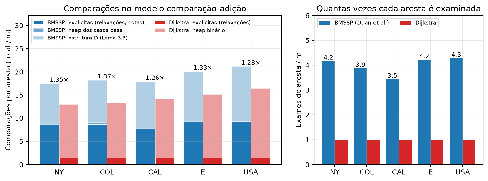
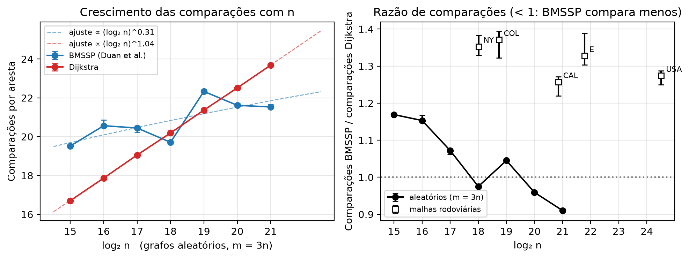

# SortingBarrier-vs-Djikstra

Implementação em Python do algoritmo de **Duan, Mao, Mao, Shu e Yin (2025), "Breaking the Sorting
Barrier for Directed Single-Source Shortest Paths"** ([arXiv:2504.17033](https://arxiv.org/abs/2504.17033)),
o primeiro SSSP determinístico em `O(m log^(2/3) n)` para grafos dirigidos com pesos não negativos,
e comparação experimental com o Dijkstra nas malhas rodoviárias do 9th DIMACS Implementation Challenge.

Trabalho da disciplina PCA (UnB). O repositório contém o código, o protocolo do experimento,
os dados coletados e as figuras.

- [1. O algoritmo em uma página](#1-o-algoritmo-em-uma-página)
- [2. O código](#2-o-código)
- [3. Dataset](#3-dataset)
- [4. Como rodar](#4-como-rodar)
- [5. O experimento](#5-o-experimento)
- [6. Resultados](#6-resultados)
- [7. Ambiente](#7-ambiente)
- [8. Arquivos](#8-arquivos)

---

## 1. O algoritmo em uma página

O Dijkstra extrai os vértices em ordem crescente de distância, e isso o obriga a pagar uma ordenação
(`n log n`). O artigo mostra que não é preciso ordenar todos os vértices: basta descobrir, a cada
passo, um conjunto pequeno de **pivôs** cujas subárvores cobrem o restante da fronteira, e recorrer
sobre faixas de distância cada vez menores.

Três rotinas, nomeadas como no artigo:

| Rotina | Algoritmo no artigo | O que faz |
|---|---|---|
| `FindPivots(B, S)` | Algoritmo 1 (Lema 3.2) | Faz `k` passos de Bellman-Ford a partir de `S` dentro da cota `B`. Se a fronteira cresce demais (`> k·|S|`), desiste e devolve `S` inteiro como pivôs. Senão, devolve como pivôs só as raízes de árvores de caminhos mínimos com pelo menos `k` vértices. |
| `BaseCase(B, {x})` | Algoritmo 2 | Mini-Dijkstra a partir de um único vértice, parando em `k+1` vértices extraídos ou quando a cota `B` é atingida. É a folha da recursão. |
| `BMSSP(l, B, S)` | Algoritmo 3 (Lema 3.1) | Nível `l` da recursão. Chama `FindPivots`, insere os pivôs na estrutura `D`, e repete: `Pull` retira os `M = 2^((l-1)t)` menores, recorre em `BMSSP(l-1, B_i, S_i)`, relaxa as arestas dos vértices completados e devolve a `D` o que sobrou (`Insert` para o que ficou acima de `B_i`, `BatchPrepend` para o que ficou abaixo). Para quando `|U| ≥ k·2^(lt)` ou `D` esvazia. |

A **estrutura `D`** (Lema 3.3) é uma lista de blocos ordenados que suporta `Insert` em `O(log(N/M))`
amortizado, `BatchPrepend` de `L` itens em `O(L·log(L/M))` e `Pull` dos `M` menores em `O(M)`.
Ela substitui o heap do Dijkstra e é o que faz a parte logarítmica do custo cair de `log n` para
`log^(2/3) n`.

**Parâmetros**: `k = ⌊log^(1/3) n⌋`, `t = ⌊log^(2/3) n⌋`, nível máximo `l = ⌈log n / t⌉`.
Para os grafos deste trabalho isso dá `k = 2`, `t` entre 6 e 8 e `l` entre 3 e 4.

**Modelo de custo**: comparação-adição. Só comparações e adições entre valores de distância contam.
É nesse modelo que o artigo prova `O(m log^(2/3) n)`, e é nele que medimos.

**Hipótese 2.1 (ordem total)**: o artigo supõe que todos os caminhos têm comprimentos distintos. O
código realiza isso comparando chaves `(distância, nº de arestas, vértice)` e, em empate total,
o predecessor, de modo que o algoritmo funciona em grafos reais com muitos pesos repetidos.

---

## 2. O código

Quatro módulos, sem dependências externas além do `matplotlib` para as figuras.

### `bmssp.py`: o algoritmo

| Símbolo | Linha | Papel |
|---|---|---|
| `Graph` | 49 | Grafo dirigido. `adj[u]` é uma tupla intercalada `(v0, w0, v1, w1, ...)` com objetos `int` compartilhados: 16 bytes por arco em vez de ~160 de uma lista de tuplas. É o que permite carregar o grafo USA (58 M arcos) em ~3 GB. `add_edge` acumula; `arcs(u)` itera em pares. |
| `to_constant_degree` | 74 | Transformação da Seção 2 do artigo: cada vértice vira um ciclo de peso 0 com um nó por aresta incidente, de modo que todo grau fique ≤ 2. Usada só para validar que o algoritmo se comporta igual com e sem a hipótese de grau constante. |
| `_Block`, `BlockDS` | 111, 122 | A estrutura `D` do Lema 3.3. `D0` é um `deque` de blocos recebidos por `BatchPrepend`; `D1` é uma lista de blocos com cotas superiores (`uppers`), localizados por `bisect`. `where` mapeia chave → bloco para remoção em `O(1)`. Blocos com mais de `M` itens são divididos pela mediana (`_split`). `pull` recolhe os primeiros blocos até somar `M` itens, ordena só se passou de `M`, apaga e devolve também a nova cota `x`. Com `contar=True` estima as comparações de `bisect`, `sort` e `min`. |
| `DuanSSSP` | 286 | O solver. Guarda `d` (distância provisória), `h` (nº de arestas, desempate) e `pred`. `key(v)` monta a chave da ordem total; `_can_relax` aplica a relaxação com `≤` da Observação 3.4; `_apply` atualiza `d`, `h`, `pred`. |
| `DuanSSSP.find_pivots` | 363 | Algoritmo 1. |
| `DuanSSSP.base_case` | 433 | Algoritmo 2, com `heapq` e remoção preguiçosa. |
| `DuanSSSP.bmssp` | 501 | Algoritmo 3. Registra por nível (`self.niveis`) o número de chamadas, as parciais, `|S|` e `|U|` máximos e as cotas do Lema 3.9. |
| `DuanSSSP._fecha_contagem` | 592 | Consolida as contagens no modelo comparação-adição (tabela abaixo). |
| `DuanSSSP.run` | 605 | Chama `bmssp(l, ∞, {s})` e devolve o vetor de distâncias. |
| `dijkstra` | 617 | Dijkstra com heap binário e remoção preguiçosa. O laço é duplicado para que a versão cronometrada não pague o teste `if contar`. |
| `random_graph` | 682 | Grafos aleatórios: árvore geradora com arcos nos dois sentidos (todo vértice alcança todos) mais arcos aleatórios até `m`. |
| `main` | 702 | CLI com logs por nível de recursão, útil para acompanhar a execução em grafos pequenos. |

**O que é contado como comparação.** Tudo o que é exato é contado por eventos; o que depende da
implementação interna do heap e da estrutura `D` é estimado por operação.

| Contador | Como é obtido |
|---|---|
| `arestas_examinadas` | uma adição `d[u] + w` e uma comparação com `d[v]` por aresta examinada (exato) |
| `heap_pops` | uma comparação por extração, para o teste de entrada obsoleta (exato) |
| `comparacoes_cotas` | comparações com as cotas `B`, `B_i`, `B'_i` e o teste de aresta justa no `FindPivots` (exato, por diferença dos contadores de relaxação) |
| `comparacoes_heap_est` | `⌈log₂ h⌉` por push e `2⌈log₂ h⌉` por pop, `h` o tamanho do heap no momento |
| `comparacoes_D_est` | `bisect` no `Insert`, `sort` nas divisões e no `Pull`, `min` das cotas |
| `comparacoes_total` | soma dos anteriores |

O Dijkstra é contado com as mesmas regras (`arestas_examinadas + pops + heap_est`).

### `dimacs.py`: leitura e validação

`load_gr(caminho, Graph)` lê um `.gr` ou `.gr.gz` do DIMACS direto para a representação compacta:
arcos em `array`, ordenação por origem por contagem, e montagem das tuplas intercaladas. Nunca cria
listas por vértice, por isso o pico de memória fica em ~1,6× o tamanho final.
`random_sources(n, quantidade, seed)` sorteia as fontes do benchmark de forma reprodutível.
`python3 dimacs.py --check arquivo.gr.gz` confere a contagem de arcos, pesos negativos, laços,
grau máximo e vértices isolados.

### `benchmark.py`: o protocolo

Para cada grafo e cada fonte sorteada:

1. Os dois algoritmos partem da **mesma fonte**.
2. A **ordem alterna** a cada fonte (BMSSP primeiro nas pares, Dijkstra nas ímpares) para que nenhum
   dos dois se beneficie sistematicamente do cache aquecido pelo outro.
3. Cada execução cronometrada roda com o **garbage collector desligado**, e a carga do grafo fica
   fora do tempo.
4. As **distâncias são conferidas** vértice a vértice; qualquer divergência aborta com código 1.
5. Uma **segunda execução de cada algoritmo**, com `contar=True`, coleta as comparações. Ela não entra
   no tempo, então a instrumentação não contamina a medida.
6. Há um **aquecimento** (uma execução de cada) antes da primeira fonte de cada grafo.

A saída é um CSV com uma linha por par de execuções e ~100 colunas: identificação do grafo e dos
parâmetros (`n`, `m`, `k`, `t`, `nivel_topo`, `fonte`, `primeiro`), tempos e razão, todos os
contadores do BMSSP e do Dijkstra com prefixos `bmssp_` e `dijkstra_`, `razao_comparacoes`, e para
cada nível `l` de 0 a 6 as colunas `nivel{l}_{chamadas, parciais, iteracoes, S_max, S_cota, U_max,
U_cota, U_medio}`.

### `graficos.py`: as figuras

Lê os CSVs e escreve `figuras/fig1..fig8` em PNG e PDF. Cada função `fig_*` gera uma figura.

---

## 3. Dataset

Malhas rodoviárias dos EUA do 9th DIMACS Implementation Challenge, série `USA-road-d` (pesos =
distância). Grafos dirigidos: cada via de mão dupla aparece como dois arcos. Todos são fortemente
conexos na prática (toda fonte sorteada alcançou todos os vértices).

| Arquivo | Vértices | Arcos | .gz |
|---|---|---|---|
| USA-road-d.NY.gr.gz | 264.346 | 733.846 | 3,7 MB |
| USA-road-d.COL.gr.gz | 435.666 | 1.057.066 | 5,8 MB |
| USA-road-d.CAL.gr.gz | 1.890.815 | 4.657.742 | 27 MB |
| USA-road-d.E.gr.gz | 3.598.623 | 8.778.114 | 52 MB |
| USA-road-d.USA.gr.gz | 23.947.347 | 58.333.344 | 351 MB |

Os arquivos não estão no repositório. Baixe para uma pasta `data/` ao lado dele:

```bash
mkdir -p ../data && cd ../data
for g in NY COL CAL E USA; do
  curl -fLO https://www.diag.uniroma1.it/challenge9/data/USA-road-d/USA-road-d.$g.gr.gz
done
gzip -t *.gz
python3 ../SortingBarrier-vs-Djikstra/dimacs.py --check USA-road-d.NY.gr.gz
```

O servidor às vezes encerra conexões longas; se `gzip -t` falhar, baixe o arquivo de novo do zero
(retomar com `curl -C -` produziu um arquivo corrompido durante este trabalho).

Formato (`.gr`, texto dentro do gzip): linhas `c` são comentários, `p sp n m` é o cabeçalho e
cada `a u v w` é um arco dirigido `u → v` de peso `w`, com vértices de 1 a `n`.

---

## 4. Como rodar

Requisitos: Python 3.12 (sem dependências para os algoritmos). Para as figuras:

```bash
python3 -m venv ../.venv && ../.venv/bin/pip install matplotlib
```

Acompanhar o algoritmo em um grafo pequeno, com log de cada chamada recursiva:

```bash
python3 bmssp.py --exemplo
python3 bmssp.py -n 50 --seed 3 --log DEBUG
python3 bmssp.py -n 3000 --seed 7 --grau-constante --log WARNING
```

Rodar as três etapas do experimento (tempos aproximados nesta máquina):

```bash
# Etapa 1: grafos reais, parâmetros do artigo (~1 h para NY, COL, CAL, E; ~45 min para o USA)
python3 benchmark.py ../data/USA-road-d.{NY,COL,CAL,E}.gr.gz --fontes 10 --saida resultados.csv
python3 benchmark.py ../data/USA-road-d.USA.gr.gz --fontes 3 --saida resultados_usa.csv

# Etapa 2: escada sintética (~15 min)
python3 benchmark.py --sintetico 15 16 17 18 19 20 21 --fontes 3 --saida resultados_sintetico.csv

# Etapa 3: controle com k e t fixos, só tempo (~15 min)
python3 benchmark.py ../data/USA-road-d.{NY,COL,CAL,E}.gr.gz --fontes 3 -k 2 -t 6 --sem-contagem --saida resultados_kt_fixo.csv

# Figuras
../.venv/bin/python graficos.py
```

Memória: o USA usa ~3,2 GB para o grafo e o benchmark completo chega a 11,5 GB de pico (dois
solvers mais a execução de contagem). O grafo E fica em ~2 GB.

---

## 5. O experimento

Todas as etapas compartilham o protocolo da seção 2 (`benchmark.py`). A métrica de complexidade é a
**contagem de comparações**, porque é a grandeza sobre a qual o artigo faz afirmações. O tempo de
parede entra como medida prática: em Python o custo por aresta do próprio Dijkstra quadruplica ao
longo da escada por efeito de cache, então ele não serve para ajustar expoentes.

### Etapa 1: grafos reais com os parâmetros do artigo

**Pergunta.** Em dados reais, quem ganha e por quanto?

**Como.** As cinco malhas rodoviárias, com `k` e `t` calculados de cada grafo como no artigo. Dez
fontes sorteadas por grafo (seed 42), três no USA.

**Mede.** Tempo, comparações separadas por origem, quantas vezes cada aresta é examinada, chamadas e
cotas por nível.

### Etapa 2: escada sintética

**Pergunta.** O crescimento com `n` segue `O(m log^(2/3) n)` contra `O(m log n)`?

**Por que grafos sintéticos.** Complexidade é uma afirmação sobre como o custo cresce quando só `n`
muda. Os cinco grafos reais têm estruturas diferentes entre si, então uma diferença entre NY e CAL
pode ser tamanho ou pode ser geografia. A escada fixa a família (aleatórios com `m = 3n`, pesos
inteiros em `[1, 10000]`, seed 7) e varia só `n`, de `2^15` a `2^21`. Três fontes por tamanho.

**Mede.** Comparações por aresta em função de `log n`, razão de comparações, razão de tempo.

### Etapa 3: controle de parâmetros

**Pergunta.** O COL destoou na etapa 1 com razão de tempo 13 contra 9 dos outros. É culpa do
`t = 7` ou da estrutura do grafo?

**Como.** NY, COL, CAL e E de novo, com `k = 2` e `t = 6` fixos em todos. Assim a única diferença
entre os grafos é o grafo. Três fontes, só tempo.

---

## 6. Resultados

Todos os 76 pares de execuções produziram distâncias idênticas ao Dijkstra.

### Etapa 1

Medianas entre as fontes. "Exames" é quantas vezes cada aresta é examinada (o Dijkstra examina
cada uma exatamente uma vez).

| Grafo | n | k, t, l | Fontes | BMSSP | Dijkstra | Razão tempo | Razão comparações | Exames |
|---|---|---|---|---|---|---|---|---|
| NY | 264 k | 2, 6, 4 | 10 | 2,23 s | 0,24 s | 9,1 | 1,35 | 4,2 |
| COL | 436 k | 2, 7, 3 | 10 | 4,98 s | 0,38 s | 13,0 | 1,37 | 3,9 |
| CAL | 1,89 M | 2, 7, 3 | 10 | 16,8 s | 1,84 s | 9,1 | 1,26 | 3,5 |
| E | 3,60 M | 2, 7, 4 | 10 | 32,7 s | 3,48 s | 9,4 | 1,33 | 4,2 |
| USA | 23,9 M | 2, 8, 4 | 3 | 233 s | 27,4 s | 8,5 | 1,27 | 4,3 |

Em tempo o Dijkstra vence por 8,5 a 13 vezes. Em comparações, o BMSSP custa só 26% a 37% a mais,
e a parte logarítmica dele (estrutura `D`) já é mais barata que o heap do Dijkstra em todos os
grafos. O custo extra está em examinar cada aresta 3,5 a 4,3 vezes (`FindPivots` relaxa, a recursão
relaxa de novo, o `BaseCase` relaxa de novo). As constantes normalizadas são estáveis em todos os
tamanhos: `comparações / (m·log^(2/3) n)` entre 2,4 e 2,6 para o BMSSP e `comparações / (m·log n)`
entre 0,67 e 0,72 para o Dijkstra.



Outras figuras desta etapa em `figuras/`: `fig1_tempo_reais` (tempo por grafo) e `fig8_dispersao_fontes` (dispersão entre fontes).

### Etapa 2

| n | Razão tempo | Comp./aresta BMSSP | Comp./aresta Dijkstra | Razão comparações |
|---|---|---|---|---|
| 2^15 | 5,50 | 19,5 | 16,7 | 1,17 |
| 2^16 | 4,70 | 20,6 | 17,9 | 1,15 |
| 2^17 | 3,66 | 20,5 | 19,1 | 1,07 |
| 2^18 | 2,88 | 19,7 | 20,2 | 0,98 |
| 2^19 | 2,85 | 22,3 | 21,4 | 1,05 |
| 2^20 | 2,38 | 21,6 | 22,5 | 0,96 |
| 2^21 | 2,25 | 21,5 | 23,7 | 0,91 |

As comparações do Dijkstra crescem com `log n` (expoente ajustado 1,04). As do BMSSP ficam quase
planas (expoente 0,31, abaixo dos 0,67 da cota). As curvas cruzam em `2^18` e a partir de `2^20` o
BMSSP compara menos. A razão de tempo cai de 5,5 para 2,25 e ainda está caindo em `2^21`.



Constantes ocultas (comparações divididas pela cota teórica): `figuras/fig5_constantes`. Tempo absoluto e razão de tempo na escada: `figuras/fig4_escada_tempo`.

### Etapa 3

| Grafo | Razão (artigo) | Razão (k=2, t=6) | Casos base (artigo) | Casos base (fixo) |
|---|---|---|---|---|
| NY | 9,1 (t=6) | 9,0 | 12 k | 12 k |
| COL | 13,0 (t=7) | 12,0 | 199 k | 101 k |
| CAL | 9,1 (t=7) | 9,7 | 386 k | 157 k |
| E | 9,4 (t=7) | 8,9 | 350 k | 120 k |

Fixar `t` tira um ponto do COL, que continua três pontos acima dos outros com parâmetros iguais.
Um quarto do desvio é parâmetro, três quartos é estrutura do grafo. O BMSSP é sensível ao grafo de
um modo que o Dijkstra não é.

Figura: `figuras/fig7_kt_fixo`.

### Cotas do Lema 3.9

O lema garante `|U| ≤ 4k·2^(lt)` e `|S| ≤ 2^(lt)` em toda chamada de nível `l`. Em todos os grafos
e níveis, `|U|` ficou abaixo de 33% da cota e `|S|` no máximo igual à cota (igualdade só nos níveis
0 e 1, onde ela vale 1 e `2^t`). Figura: `figuras/fig6_niveis_lema39`.

### Em resumo

- No modelo do artigo (comparações), o BMSSP custa 26% a 37% a mais nos grafos reais e passa a
  custar menos que o Dijkstra a partir de `n ≈ 2^18` nos grafos sintéticos.
- O crescimento com `n` bate com a teoria: expoente 0,31 em `log n` contra 1,04, constantes planas.
- Em tempo de parede o Dijkstra vence por 8,5 a 13 vezes, por examinar cada aresta uma vez contra
  3,5 a 4,3.
- A sensibilidade à estrutura do grafo (COL) é majoritariamente do grafo, não dos parâmetros.
- Todas as cotas do Lema 3.9 fecharam.

---

## 7. Ambiente

Intel Core i5-1135G7 (4 núcleos, L2 5 MiB, L3 8 MiB), 24 GB de RAM, Ubuntu 24.04.5, Python 3.12.3,
sem bibliotecas de aceleração. Tudo single-thread. Os tempos são por fonte, medidos com
`time.perf_counter` e GC desligado. As fontes dos CSVs são 1-indexadas como nos arquivos DIMACS.

---

## 8. Arquivos

| Arquivo | Conteúdo |
|---|---|
| `bmssp.py`, `dimacs.py`, `benchmark.py`, `graficos.py` | código |
| `resultados.csv` | etapa 1, NY/COL/CAL/E, 40 linhas |
| `resultados_usa.csv` | etapa 1, USA, 3 linhas |
| `resultados_sintetico.csv` | etapa 2, 21 linhas |
| `resultados_kt_fixo.csv` | etapa 3, 12 linhas (sem contagem de comparações) |
| `benchmark.log`, `benchmark_usa.log`, `benchmark_sintetico.log` | saída legível das execuções |
| `figuras/` | fig1 a fig8 em PNG e PDF |

Referência: R. Duan, J. Mao, X. Mao, X. Shu, L. Yin. *Breaking the Sorting Barrier for Directed
Single-Source Shortest Paths.* arXiv:2504.17033v2, 2025.
