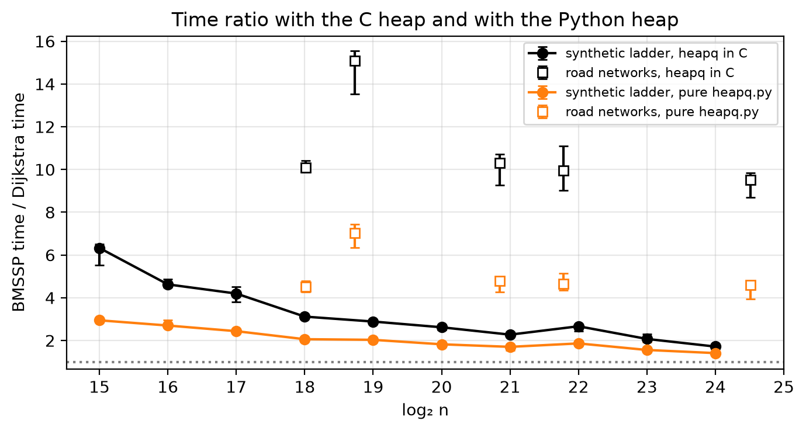

# Single-Source Shortest Paths in Directed Graphs: Dijkstra and BMSSP (Breaking the Sorting Barrier)

Python implementation of the algorithm by **Duan, Mao, Mao, Shu and Yin (2025), "Breaking the Sorting
Barrier for Directed Single-Source Shortest Paths"** ([arXiv:2504.17033](https://arxiv.org/abs/2504.17033)),
the first deterministic SSSP in `O(m log^(2/3) n)` for directed graphs with non-negative weights,
and an experimental comparison with Dijkstra on the road networks of the 9th DIMACS Implementation Challenge.

Project for the PCA course (UnB). The repository contains the code, the experiment protocol,
the collected data and the figures.

- [1. The algorithm on one page](#1-the-algorithm-on-one-page)
- [2. The code](#2-the-code)
- [3. Dataset](#3-dataset)
- [4. How to run](#4-how-to-run)
- [5. The experiment](#5-the-experiment)
- [6. Results](#6-results)
- [7. Environment](#7-environment)
- [8. Files](#8-files)

---

## 1. The algorithm on one page

Dijkstra extracts the vertices in increasing order of distance, and that forces it to pay for a sort
(`n log n`). The paper shows that sorting all the vertices is not necessary: it is enough to find, at each
step, a small set of **pivots** whose subtrees cover the rest of the frontier, and to recurse
over ever smaller distance ranges.

Three routines, named as in the paper:

| Routine | Algorithm in the paper | What it does |
|---|---|---|
| `FindPivots(B, S)` | Algorithm 1 (Lemma 3.2) | Runs `k` Bellman-Ford steps from `S` within the bound `B`. If the frontier grows too much (`> k·|S|`), it gives up and returns all of `S` as pivots. Otherwise, it returns as pivots only the roots of shortest-path trees with at least `k` vertices. |
| `BaseCase(B, {x})` | Algorithm 2 | Mini-Dijkstra from a single vertex, stopping after `k+1` extracted vertices or when the bound `B` is reached. It is the leaf of the recursion. |
| `BMSSP(l, B, S)` | Algorithm 3 (Lemma 3.1) | Level `l` of the recursion. Calls `FindPivots`, inserts the pivots into the structure `D`, and repeats: `Pull` removes the `M = 2^((l-1)t)` smallest, recurses into `BMSSP(l-1, B_i, S_i)`, relaxes the edges of the completed vertices and returns to `D` what is left (`Insert` for what ended up above `B_i`, `BatchPrepend` for what ended up below). Stops when `|U| ≥ k·2^(lt)` or `D` becomes empty. |

The **structure `D`** (Lemma 3.3) is a list of sorted blocks that supports `Insert` in `O(log(N/M))`
amortized, `BatchPrepend` of `L` items in `O(L·log(L/M))` and `Pull` of the `M` smallest in `O(M)`.
It replaces Dijkstra's heap and is what brings the logarithmic part of the cost down from `log n` to
`log^(2/3) n`.

**Parameters**: `k = ⌊log^(1/3) n⌋`, `t = ⌊log^(2/3) n⌋`, maximum level `l = ⌈log n / t⌉`.
For the graphs in this project this gives `k = 2`, `t` between 6 and 8 and `l` between 3 and 4.

**Cost model**: comparison-addition. Only comparisons and additions between distance values count.
It is in this model that the paper proves `O(m log^(2/3) n)`, and it is in this model that we measure.

**Assumption 2.1 (total order)**: the paper assumes that all paths have distinct lengths. The
code realizes this by comparing keys `(distance, no. of edges, vertex)` and, on a complete tie,
the predecessor, so that the algorithm works on real graphs with many repeated weights.

### Comparison with the literature

| Result | Graph | Time | Model |
|---|---|---|---|
| Dijkstra (1959) with a binary heap, as in `dijkstra.py` | directed, weights ≥ 0 | `O(m log n)` | comparison-addition |
| Dijkstra with a Fibonacci heap (Fredman and Tarjan, 1987) | directed, weights ≥ 0 | `O(m + n log n)` | comparison-addition |
| Bellman-Ford | directed, arbitrary weights | `O(mn)` | comparison-addition |
| Thorup (1999) | undirected, integer weights | `O(m)` | RAM (outside the comparison-addition model) |
| Duan, Mao, Shu and Yin (2023), randomized | undirected, real weights | `O(m √(log n · log log n))` | comparison-addition |
| **Duan, Mao, Mao, Shu and Yin (2025)**, this project | directed, real weights ≥ 0 | `O(m log^(2/3) n)` | comparison-addition, deterministic |

Dijkstra's `O(m + n log n)` is the "sorting barrier": since it returns the vertices in order of
distance, it cannot be faster than sorting. The 2025 result is the first deterministic one to
break this barrier on sparse directed graphs (`m = O(n)`), combining Dijkstra with `k` steps
of Bellman-Ford (`FindPivots`) inside a recursion over distance ranges (`BMSSP`). Section 6
compares the paper's predictions with what we measured.

References: E. W. Dijkstra, *A note on two problems in connexion with graphs*, Numerische Mathematik
1, 1959. M. L. Fredman, R. E. Tarjan, *Fibonacci heaps and their uses in improved network optimization
algorithms*, J. ACM 34(3), 1987. M. Thorup, *Undirected single-source shortest paths with positive
integer weights in linear time*, J. ACM 46(3), 1999. R. Duan, J. Mao, X. Shu, L. Yin, *A randomized
algorithm for single-source shortest path on undirected real-weighted graphs*, FOCS 2023.

---

## 2. The code

No external dependencies other than `matplotlib` for the figures. Implementation, data and results
live in separate folders:

```
src/                      implementation
├── algorithms/           the compared algorithms
│   ├── duan.py           DuanSSSP: Algorithms 1, 2 and 3 of Duan et al.
│   ├── block_ds.py       data structure D of Lemma 3.3 (used only by duan.py)
│   ├── dijkstra.py       reference Dijkstra
│   └── common.py         infrastructure shared by both: constants, log, heap and counting
├── graphs/               graph representation and loading
│   ├── graph.py          Graph and graph generators
│   └── dimacs.py         reading and validation of the DIMACS files
├── bmssp.py              CLI: runs both algorithms on a graph, with logs, and checks the distances
├── benchmark.py          experiment protocol (generates the CSVs)
└── plots.py              figures from the CSVs
datasets/                 DIMACS graphs (downloaded, not in git; see datasets/README.md) and the test/ instance
results/
├── csv/                  collected data per stage
├── logs/                 readable output of the benchmark runs
└── figures/              figures per stage, in PNG and PDF
relatorio/                implementation section in LaTeX
```

Each algorithm lives in its own file (`duan.py` and `dijkstra.py`); what the two need to share,
so that they are swapped and counted the same way, lives in `common.py`. All commands below are
run from the repository root.

### `duan.py` and `block_ds.py`: the algorithm

| Symbol | Line | Role |
|---|---|---|
| `DuanSSSP` | `src/algorithms/duan.py:54` | The solver. Stores `d` (tentative distance), `h` (no. of edges, tie-breaking) and `pred`. Each of the three algorithms builds the total-order key `(d, h, v)` and performs the relaxation with the `≤` of Remark 3.4 in its own body, without helper methods. This is on purpose: one Python method call per examined arc would add interpreter overhead to the timed runs that has nothing to do with the algorithm. |
| `DuanSSSP.find_pivots` | `src/algorithms/duan.py:132` | Algorithm 1. |
| `DuanSSSP.base_case` | `src/algorithms/duan.py:219` | Algorithm 2, with a binary heap (`use_heap`) and lazy deletion. |
| `DuanSSSP.bmssp` | `src/algorithms/duan.py:301` | Algorithm 3. Records per level (`self.levels`) the number of calls, the partial executions, the maximum `|S|` and `|U|` and the bounds of Lemma 3.9. |
| `DuanSSSP.run` | `src/algorithms/duan.py:418` | Calls `bmssp(l, ∞, {s})`, consolidates the counts in the comparison-addition model (table below) and returns the distance vector. |
| `_Block`, `_counted_bisect`, `_partition`, `_select`, `BlockDS` | `src/algorithms/block_ds.py:23, 33, 49, 61, 97` | The structure `D` of Lemma 3.3. `D0` is a `deque` of blocks received through `BatchPrepend`; `D1` is a list of blocks with upper bounds (`uppers`), located by `bisect`. `where` maps key → block for `O(1)` deletion. The `k` smallest (block split at the median, `Pull`, `BatchPrepend`) are chosen by `_select`, a quickselect with a random pivot: `O(L)` expected comparisons, one per element in each partition (`_partition`). The paper cites the deterministic selection of [BFP+73] for the same step; only the guarantee changes, from worst case to expected. With `count=True` it counts every comparison executed (`_counted_bisect`, `_partition`). |

### `dijkstra.py`: the reference

| Symbol | Line | Role |
|---|---|---|
| `dijkstra` | `src/algorithms/dijkstra.py:13` | Dijkstra with a binary heap (`use_heap`) and lazy deletion, counted with the same rules as `DuanSSSP`. |

### `common.py`, `graph.py` and `bmssp.py`: infrastructure and CLI

| Symbol | Line | Role |
|---|---|---|
| `use_heap` | `src/algorithms/common.py:27` | Chooses the heap of both algorithms: `"c"` is the accelerated `heapq` (default); `"python"` loads the same `heapq.py` from the standard library without the `_heapq` module, to measure the interpreter's share. |
| `CountedKey` | `src/algorithms/common.py:52` | Key of the counting run: each `<` executed increments `CountedKey.n`. This is what makes the counting of the heap and of the structure `D` exact. |
| `heap_ops` | `src/algorithms/common.py:70` | Returns the `(push, pop)` pair used by `base_case` and by `dijkstra`: the heap chosen in `use_heap` and, with `count=True`, with the items wrapped in `CountedKey`. |
| `mismatches` | `src/algorithms/common.py:84` | `mismatches(a, b)`: list of the vertices whose distances differ beyond a relative tolerance of 1e-9. It is the DuanSSSP × Dijkstra check used by `bmssp.py` and `benchmark.py`. |
| `Graph` | `src/graphs/graph.py:9` | Directed graph. `adj[u]` is an interleaved tuple `(v0, w0, v1, w1, ...)` with shared `int` objects: 16 bytes per arc instead of ~160 for a list of tuples. This is what allows loading the USA graph (58 M arcs) in ~3 GB. `add_edge` accumulates; `arcs(u)` iterates in pairs. |
| `to_constant_degree` | `src/graphs/graph.py:42` | Transformation from Section 2 of the paper: each vertex becomes a weight-0 cycle with one node per incident edge, so that every degree is ≤ 2. Used only to validate that the algorithm behaves the same with and without the constant-degree assumption. |
| `random_graph` | `src/graphs/graph.py:96` | Random graphs: a spanning tree with arcs in both directions (every vertex reaches every other) plus random arcs up to `m`. |
| `main` | `src/bmssp.py:25` | CLI with logs per recursion level, useful for following the execution on small graphs. |

**What is counted as a comparison.** Everything is counted by events, exactly. What depends on the
internal implementation of the heap and of the structure `D` is counted in a separate run, in which the keys
are wrapped in `CountedKey` and each `<` executed increments a counter.

| Counter | How it is obtained |
|---|---|
| `arcs_examined` | one addition `d[u] + w` and one comparison with `d[v]` per examined edge |
| `heap_pops` | one comparison per extraction, for the stale-entry test |
| `bound_comparisons` | comparisons with the bounds `B`, `B_i`, `B'_i` and the tight-edge test in `FindPivots` (by difference of the relaxation counters) |
| `heap_comparisons` | each `<` executed by `heapq` (`CountedKey` items) |
| `D_comparisons` | each `<` executed in the structure `D`: binary search of the bounds, quickselect partitions, improvement tests in `Insert` and in `BatchPrepend`, minima of `Pull` |
| `total_comparisons` | sum of the above |

Dijkstra is counted with the same rules (`arcs_examined + pops + heap_comparisons`).

### `dimacs.py`: reading and validation

`load_gr(path, Graph)` reads a DIMACS `.gr` or `.gr.gz` directly into the compact representation:
arcs in an `array`, counting sort by source, and assembly of the interleaved tuples. It never creates
per-vertex lists, so the memory peak stays at ~1.6× the final size.
`random_sources(n, count, seed)` draws the benchmark sources reproducibly.
`python3 src/graphs/dimacs.py --check file.gr.gz` checks the arc count, negative weights, self-loops,
maximum degree and isolated vertices.

### `benchmark.py`: the protocol

For each graph and each drawn source:

1. Both algorithms start from the **same source**.
2. The **order alternates** at each source (BMSSP first on even ones, Dijkstra on odd ones) so that neither
   of the two systematically benefits from the cache warmed up by the other.
3. Each timed run executes with the **garbage collector disabled**, and loading the graph is kept
   out of the timing.
4. The **distances are checked** vertex by vertex; any mismatch aborts with exit code 1.
5. A **second run of each algorithm**, with `count=True`, collects the comparisons. It does not count
   towards the time, so the instrumentation does not contaminate the measurement.
6. There is a **warm-up** (one run of each) before the first source of each graph.
7. With `--heap both`, each source is timed twice per algorithm: with the C `heapq` and with
   the pure `heapq.py`, swapped in both algorithms at the same time (Dijkstra and `BaseCase`). The
   counting is done once per source, because it does not depend on the heap.

The output is a CSV with one row per pair of runs and ~100 columns: identification of the graph and of the
parameters (`n`, `m`, `k`, `t`, `top_level`, `heap`, `source`, `first`), times and ratio, all the
BMSSP and Dijkstra counters with prefixes `bmssp_` and `dijkstra_`, `comparison_ratio`, and for
each level `l` from 0 to 6 the columns `level{l}_{calls, partials, iterations, S_max, S_bound, U_max,
U_bound, U_mean}`.

### `plots.py`: the figures

Reads the CSVs and writes the figures in PNG and PDF, separated by stage: `results/figures/stage1` (fig1, fig2,
fig6, fig8), `results/figures/stage2` (fig3, fig4, fig5 and the `prediction` subfolder, with the extrapolations),
`results/figures/stage3` (fig7) and `results/figures/supplement` (fig9, heap in Python). Each `fig_*` function generates one
figure. Figures 1 to 8 use the rows with `heap=c`.

---

## 3. Dataset

US road networks from the 9th DIMACS Implementation Challenge, series `USA-road-d` (weights =
distance). Directed graphs: each two-way road appears as two arcs. All are strongly
connected in practice (every drawn source reached all vertices).

| File | Vertices | Arcs | .gz |
|---|---|---|---|
| USA-road-d.NY.gr.gz | 264,346 | 733,846 | 3.7 MB |
| USA-road-d.COL.gr.gz | 435,666 | 1,057,066 | 5.8 MB |
| USA-road-d.CAL.gr.gz | 1,890,815 | 4,657,742 | 27 MB |
| USA-road-d.E.gr.gz | 3,598,623 | 8,778,114 | 52 MB |
| USA-road-d.USA.gr.gz | 23,947,347 | 58,333,344 | 351 MB |

The files are not in the repository: download them into the `datasets/` folder following
[`datasets/README.md`](datasets/README.md).

The server sometimes closes long connections; if `gzip -t` fails, download the file again from scratch
(resuming with `curl -C -` produced a corrupted file during this project).

Format (`.gr`, text inside the gzip): `c` lines are comments, `p sp n m` is the header and
each `a u v w` is a directed arc `u → v` of weight `w`, with vertices from 1 to `n`.

---

## 4. How to run

Requirements: Python 3.12 (no dependencies for the algorithms). For the figures:

```bash
python3 -m venv .venv && .venv/bin/pip install matplotlib
```

Follow the algorithm on a small graph, with a log of each recursive call:

```bash
python3 src/bmssp.py --example
python3 src/bmssp.py -n 50 --seed 3 --log DEBUG
python3 src/bmssp.py -n 3000 --seed 7 --constant-degree --log WARNING
```

Quick test of the experimental routine on the versioned test instance `datasets/test/example.gr`
(the 11-vertex example graph, DIMACS format):

```bash
python3 src/benchmark.py datasets/test/example.gr --sources 3 --output /tmp/test.csv
python3 src/bmssp.py --dimacs datasets/test/example.gr --source 1      # same instance, with the recursion log
```

Run the three stages of the experiment (approximate times on this machine):

```bash
# Stage 1: real graphs, paper parameters, heap in C and in Python (~45 min for NY, COL, CAL, E; ~1 h for USA)
python3 src/benchmark.py datasets/USA-road-d.{NY,COL,CAL,E}.gr.gz --sources 10 --heap both --output results/csv/results.csv
python3 src/benchmark.py datasets/USA-road-d.USA.gr.gz --sources 3 --heap both --output results/csv/results_usa.csv

# Stage 2: synthetic ladder (~2.5 h; only up to 2^21 is ~30 min)
python3 src/benchmark.py --synthetic 15 16 17 18 19 20 21 22 23 24 --sources 3 --heap both --output results/csv/results_synthetic.csv

# Stage 3: control with fixed k and t, time only (~15 min)
python3 src/benchmark.py datasets/USA-road-d.{NY,COL,CAL,E}.gr.gz --sources 3 -k 2 -t 6 --no-count --output results/csv/results_kt_fixed.csv

# Figures
.venv/bin/python src/plots.py
```

Memory: USA uses ~3.2 GB for the graph and the full benchmark reaches a 12.5 GB peak (two
solvers plus the counting run). The `2^24` random graph takes ~10 GB and E ~2 GB.

---

## 5. The experiment

All stages share the protocol of section 2 (`benchmark.py`). The complexity metric is the
**exact comparison count**: it is the quantity about which the paper makes claims and it is
deterministic (the same source gives the same count on any machine). Wall-clock time enters as a
practical measure: it is the count times a cost per comparison that is not the same for the two algorithms and
that varies with cache and interpreter, so it is not suitable for fitting exponents.

### Stage 1: real graphs with the paper's parameters

**Question.** On real data, who wins and by how much?

**How.** The five road networks, with `k` and `t` computed from each graph as in the paper. Ten
sources drawn per graph (seed 42), three for USA.

**Measures.** Time, comparisons split by origin (explicit, heap, structure `D`), how many times
each edge is examined, calls and bounds per level.

### Stage 2: synthetic ladder

**Question.** How does the cost grow with `n`: as `m log^(2/3) n`, which is what the paper predicts, or
as `m log n`, which is Dijkstra?

**Why synthetic graphs.** Complexity is a claim about how the cost grows when only `n`
changes. The five real graphs have different structures from one another, so a difference between NY and CAL
may be size or may be geography. The ladder fixes the family (random with `m = 3n`, integer weights
in `[1, 10000]`, seed 7) and varies only `n`, from `2^15` to `2^24`. Three sources per size. The
`2^24` one has the size of USA and is the largest that fits in memory with the counting run.

**Measures.** Comparisons per edge as a function of `log n` with a fitted exponent, comparison ratio,
time ratio.

### Stage 3: parameter control

**Question.** COL stood out in stage 1 with a time ratio of 13 against 9 for the others. Is it due to
`t = 7` or to the structure of the graph?

**How.** NY, COL, CAL and E again, with `k = 2` and `t = 6` fixed for all of them. That way the only difference
between the graphs is the graph. Three sources, time only.

### Supplement: heap in Python

**Question.** How much of the time difference is the interpreter? Dijkstra's heap (`heapq`) runs in
C, while the pivots, the structure `D` and the BMSSP recursion run in pure Python.

**How.** Stages 1 and 2 in full, repeated with the pure `heapq.py` from the standard library in both
algorithms (`--heap both`), in the same run and with the same graph in memory as the measurements with the
C heap.

---

## 6. Results

All 146 timed runs (73 sources × 2 heaps) and the 73 counting runs produced
distances identical to Dijkstra's.

### Stage 1

Medians across sources, C heap. "Exams" is how many times each edge is examined (Dijkstra
examines each one exactly once).

| Graph | n | k, t, l | Sources | BMSSP | Dijkstra | Time ratio | Comp./edge BMSSP | Comp./edge Dijkstra | Comparison ratio | Exams |
|---|---|---|---|---|---|---|---|---|---|---|
| NY | 264 k | 2, 6, 4 | 10 | 2.35 s | 0.23 s | 10.1 | 13.1 | 5.7 | 2.29 | 4.2 |
| COL | 436 k | 2, 7, 3 | 10 | 5.49 s | 0.37 s | 15.1 | 13.3 | 6.2 | 2.16 | 3.9 |
| CAL | 1.89 M | 2, 7, 3 | 10 | 18.0 s | 1.76 s | 10.3 | 12.5 | 6.4 | 1.96 | 3.5 |
| E | 3.60 M | 2, 7, 4 | 10 | 35.1 s | 3.57 s | 9.9 | 14.3 | 6.6 | 2.16 | 4.2 |
| USA | 23.9 M | 2, 8, 4 | 3 | 255 s | 27.1 s | 9.5 | 14.5 | 7.2 | 2.04 | 4.3 |

In time Dijkstra wins by 9.5 to 15 times, and the ratio does not depend on n: NY and USA, which differ
by 90 times in size, give 10.1 and 9.5. In comparisons BMSSP costs 2.0 to 2.3 times more, and the
breakdown shows where: its explicit comparisons are 7.8 to 9.3 per edge against 1.4 for
Dijkstra, because each edge is examined 3.5 to 4.3 times (`FindPivots` relaxes, the recursion relaxes
again at each level, `BaseCase` relaxes again). The structure `D` costs 4.5 to 5.3 per edge, the
same as Dijkstra's entire heap (4.3 to 5.7): the logarithmic part of the two algorithms ties on the
roads and all of BMSSP's excess is in the repeated exams. The normalized constants are
stable across all sizes: `comparisons / (m·log^(2/3) n)` between 1.65 and 1.91 for BMSSP and
`comparisons / (m·log n)` between 0.29 and 0.33 for Dijkstra.


Other figures of this stage in `results/figures/stage1/`: `fig1_time_real` (time per graph) and `fig8_source_spread` (spread across sources).

### Stage 2

C heap, median of 3 sources per size.

| n | k, t, l | Time ratio | Comp./edge BMSSP | Comp./edge Dijkstra | Comparison ratio |
|---|---|---|---|---|---|
| 2^15 | 2, 6, 3 | 6.33 | 12.1 | 7.1 | 1.71 |
| 2^16 | 2, 6, 3 | 4.62 | 11.5 | 7.4 | 1.55 |
| 2^17 | 2, 6, 3 | 4.20 | 10.9 | 7.9 | 1.39 |
| 2^18 | 2, 6, 3 | 3.12 | 10.5 | 8.2 | 1.28 |
| 2^19 | 2, 7, 3 | 2.89 | 11.0 | 8.6 | 1.28 |
| 2^20 | 2, 7, 3 | 2.62 | 10.5 | 9.0 | 1.17 |
| 2^21 | 2, 7, 3 | 2.27 | 10.3 | 9.4 | 1.10 |
| 2^22 | 2, 7, 4 | 2.67 | 12.1 | 9.8 | 1.24 |
| 2^23 | 2, 8, 3 | 2.07 | 10.4 | 10.2 | 1.02 |
| 2^24 | 2, 8, 3 | 1.72 | 10.4 | 10.6 | **0.985** |

**The crossover happens, and it is measured.** Dijkstra's comparisons per edge grow in a straight
line with `log n`, 0.39 per doubling (fitted exponent 0.86, with the heap going from 5.7 to 9.2
per edge): this is the `Θ(m log n)` of the binary heap. BMSSP's **fall** from 12.1 to 10.4 (exponent
−0.20), due to two effects: the explicit part falls from 6.6 to 4.7 per edge, because with a larger `t` the
partial returns become rarer and each edge is examined fewer times (3.0 → 2.1), while the structure
`D` stays flat at 5.3 to 5.7 per edge, as Lemma 3.3 predicts for a `D` with linear selection. The
step at `2^22` is the extra level: `l` goes from 3 to 4 and each edge gets one more exam (3.1). The
ratio falls from 1.71 to 1.02 at `2^23` and to 0.985 at `2^24`, below 1 for all three sources
(0.992, 0.985, 0.985): **from n ≈ 1.7 × 10^7 vertices on, BMSSP makes fewer comparisons than
Dijkstra**, which is what the paper predicts. The time ratio falls from 6.3 to 1.7 and does not cross.


The normalized constants tell the same story: BMSSP's `comparisons / (m·log^(2/3) n)` falls from
1.98 to 1.25, that is, in our range it grows more slowly than the bound itself, while
Dijkstra's `comparisons / (m·log n)` stays flat at 0.44 to 0.47 (`results/figures/stage2/fig5_constants`).
Absolute time and time ratio: `results/figures/stage2/fig4_ladder_time`.

**Why so late.** With the paper's formulas, `k = 2` for any graph that fits in a machine
(`k = 3` only from `2^27` vertices on) and `t` moves up one unit every few doublings of `n`. The
parameters that carry the asymptotics barely change in the reachable range; what BMSSP gains per
doubling is only the difference between the `log n` of Dijkstra's heap and the nearly constant cost of `D`.

### Supplement: heap in Python

| Graph | Time ratio, C `heapq` | Time ratio, pure `heapq.py` | Dijkstra became slower |
|---|---|---|---|
| NY | 10.1 | 4.5 | 2.3× |
| COL | 15.1 | 7.0 | 2.1× |
| CAL | 10.3 | 4.8 | 2.2× |
| E | 9.9 | 4.7 | 2.1× |
| USA | 9.5 | 4.6 | 2.1× |
| 2^15 | 6.3 | 2.9 | 2.0× |
| 2^21 | 2.3 | 1.7 | 1.3× |
| 2^24 | 1.7 | 1.4 | 1.2× |

Replacing the C `heapq` with the pure `heapq.py` in both algorithms doubles Dijkstra's time on the
roads and cuts the ratio in half. BMSSP does not change (±2%): the `BaseCase` heap is a small
part of it. In other words, on the roads half of the time difference is the C heap; the other half is the
algorithm, four exams per edge and the structure `D` in pure Python. On the ladder the effect shrinks
with `n`: at `2^24` Dijkstra is only 21% slower with the Python heap, because its time becomes
dominated by random memory accesses and not by the heap. The crossover in time does not happen
up to `2^24` with either heap.



### Stage 3

| Graph | Ratio (paper) | Ratio (k=2, t=6) | Base cases (paper) | Base cases (fixed) |
|---|---|---|---|---|
| NY | 10.1 (t=6) | 10.2 | 12 k | 12 k |
| COL | 15.1 (t=7) | 13.3 | 199 k | 101 k |
| CAL | 10.3 (t=7) | 10.4 | 386 k | 157 k |
| E | 9.9 (t=7) | 9.6 | 350 k | 120 k |

Fixing `t` takes 1.8 points off COL's ratio and moves the others by less than 0.3; COL stays three
points above them with equal parameters. One third of the deviation is parameters, two thirds is the structure
of the graph. BMSSP is sensitive to the graph in a way that Dijkstra is not. Figure: `results/figures/stage3/fig7_kt_fixed`.

### Bounds of Lemma 3.9

The lemma guarantees `|U| ≤ 4k·2^(lt)` and `|S| ≤ 2^(lt)` in every call at level `l`. In all graphs
and levels, `|U|` stayed below 33% of the bound (worst case 0.327) and `|S|` at most equal to the bound
(equality only at levels 0 and 1, where it equals 1 and `2^t`). Figure: `results/figures/stage1/fig6_levels_lemma39`.

### Predictions (curiosity)

Extending the fits of the ladder (`results/figures/stage2/prediction/`): the comparisons-per-edge lines,
linear in `log₂ n`, meet at `n ≈ 2^24` (±3 in the exponent), which is where the measurement crossed. The
power laws of time, `n^1.12` for BMSSP and `n^1.30` for Dijkstra (`n^1.23` with the Python
heap), would meet at `n ≈ 2^28` with the C heap, at about 3 h per source and memory of
hundreds of GB, and at `n ≈ 2^29` with the Python heap. These are extrapolations from ten points over a narrow
range of `log n`, with `t` and `l` changing in steps: orders of magnitude, not predictions.

### In summary

- In the paper's model, BMSSP costs 2.0 to 2.3 times more comparisons on the real graphs and crosses
  Dijkstra on the synthetic ladder at `n ≈ 2^24`: 1.02 at `2^23`, 0.985 at `2^24`.
- The growth with `n` is as predicted: Dijkstra rises with `log n` (exponent 0.86); BMSSP stays flat
  or falls (exponent −0.20), with the structure `D` constant per edge and the exams decreasing.
- In time Dijkstra wins by 9.5 to 15 times on the roads and by 1.7 at `2^24`, and does not cross at
  any size that fits in the machine. Half of the difference on the roads is the C heap; the other
  half is the algorithm.
- The sensitivity to the graph structure (COL) comes mostly from the graph, not from the parameters.
- All the bounds of Lemma 3.9 held.

---

## 7. Environment

Intel Core i5-1135G7 (4 cores, L2 5 MiB, L3 8 MiB), 24 GB of RAM, Ubuntu 24.04.5, Python 3.12.3,
no acceleration libraries. Everything single-threaded. Times are per source, measured with
`time.perf_counter` and GC disabled. The sources in the CSVs are 1-indexed as in the DIMACS files.

---

## 8. Files

| File | Contents |
|---|---|
| `src/` | code (see section 2) |
| `datasets/` | instructions for downloading the DIMACS graphs |
| `datasets/test/example.gr` | versioned test instance: the 11-vertex example graph, DIMACS format (see section 4) |
| `relatorio/` | implementation section in LaTeX (`implementation_details.tex`) and references |
| `results/csv/results.csv` | stage 1, NY/COL/CAL/E, 80 rows (40 sources × 2 heaps) |
| `results/csv/results_usa.csv` | stage 1, USA, 6 rows |
| `results/csv/results_synthetic.csv` | stage 2, 2^15 to 2^24, 60 rows |
| `results/csv/results_kt_fixed.csv` | stage 3, 12 rows (no comparison counting) |
| `results/logs/` (`benchmark_roads.log`, `benchmark_usa.log`, `benchmark_synthetic.log`, `benchmark_kt_fixed.log`) | readable output of the runs |
| `results/figures/stage1`, `results/figures/stage2`, `results/figures/stage3`, `results/figures/supplement` | fig1 to fig9 and the predictions, in PNG and PDF, separated by stage |

Reference: R. Duan, J. Mao, X. Mao, X. Shu, L. Yin. *Breaking the Sorting Barrier for Directed
Single-Source Shortest Paths.* arXiv:2504.17033v2, 2025.
